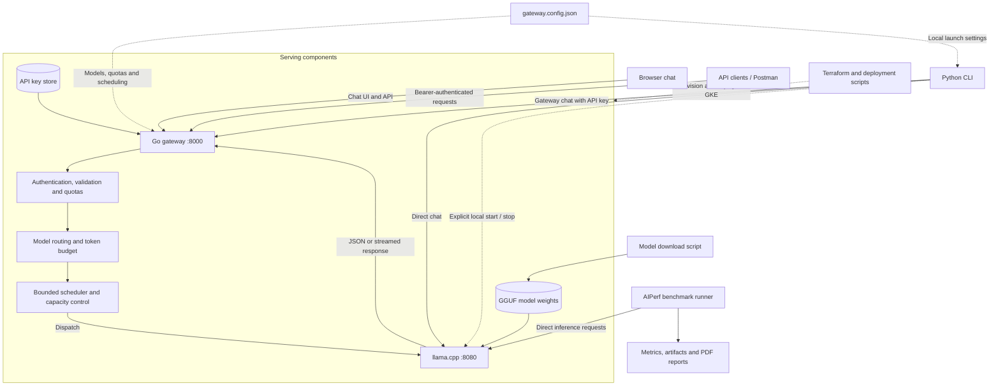

# Project architecture

The project separates inference, access control, and workload measurement.
llama.cpp owns model execution and batching; the Go gateway controls access and
decides when accepted requests can run. The Python tools manage local models
and run benchmarks.

## Overall system



Solid arrows show requests, data, or artifacts; dotted arrows show configuration
and lifecycle management. The gateway returns model responses to the requesting
client. Direct CLI and benchmark traffic bypass gateway authentication, quotas,
and scheduling. The current benchmark runner does not provide gateway API-key support.

## Local and cloud deployment

Locally, the gateway and llama.cpp run as separate processes. Model weights live
in `models/` and are downloaded separately; local startup records and logs live
in `.runtime/`. The CLI starts registered models explicitly; routing a gateway
request never starts a model automatically.

On GKE, one Pod contains the gateway and llama.cpp, which communicate over
loopback. A Kubernetes Service exposes the gateway within the cluster; users
access it through `kubectl port-forward`. Persistent volumes retain model weights
and API keys. Terraform provisions the infrastructure, while `deploy/scripts/`
builds deployment configuration and manages the workload. See the
[deployment guide](infra/README.md) for setup and operational commands.

Gateway quotas, queues, and capacity state are process-local, so the deployment
uses one replica. Restarting clears that state. Persistent keys and model files
are separate from this in-memory state. Benchmarking a cloud model through a
port-forward includes network latency; the local runner cannot measure the cloud
process's memory or capture its local runtime evidence.

## Gateway request flow

```text
API key → schema validation → user/global quotas → model/token budget
→ backend selection → bounded queue → execution → response → settlement
```

Routing chooses **where**; scheduling chooses **when**. Waiting requests reserve
tokens, not execution slots. Aliases share quotas/capacity; llama.cpp owns batching.

## Code map

| Code | Responsibility |
| --- | --- |
| `client/`, `cli.py` | Chat, saved keys, model management |
| `gateway/cmd/` | Server startup, key commands, reload, container utilities |
| `gateway/internal/api/` | Admission, forwarding, streaming, cleanup and logs |
| `gateway/internal/auth/`, `quota/` | Identity and budgets |
| `gateway/internal/registry/`, `routing/` | Models, tokenizer and destination |
| `gateway/internal/scheduler/`, `capacity/` | Waiting order and execution permits |
| `gateway/internal/chatui/` | Browser chat |
| `benchmarks/` | AIPerf runs and reports |
| `infra/`, `deploy/`, `docker/` | Terraform, Kubernetes and images |

Start reading `gateway/internal/api/admission.go`, `proxy.go`, then
`request_cleanup.go`. Queue handling lives in `gateway/internal/scheduler/`.
State is process-local: restart clears counters and waiting work.

Details: [gateway](gateway/README.md), [routing](gateway/README.routing.md),
[streaming](gateway/README.streaming.md), [cleanup](gateway/README.lifecycle.md),
[scheduler](gateway/README.scheduler.md). [Local requirements](project-requirements.html).
