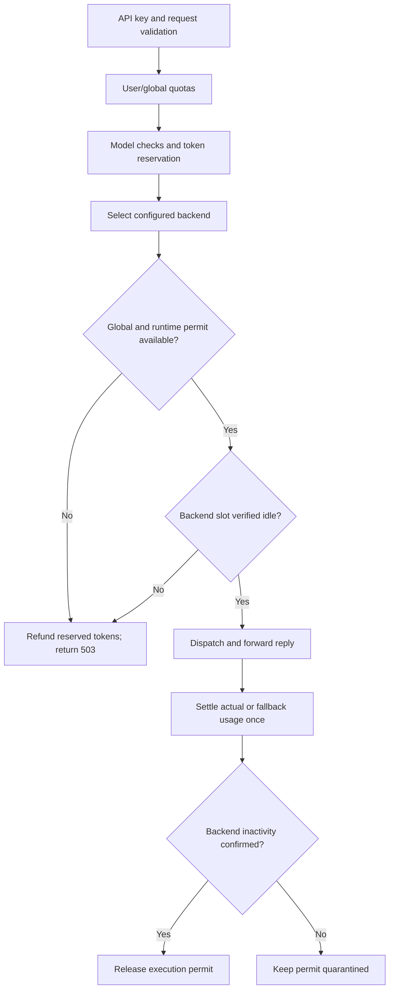

# Capacity and token settlement (GATE-07)

The gateway limits running work, settles token reservations once, and confirms
backend inactivity before making execution capacity reusable. Queueing remains
the next milestone. All counters belong to one gateway process.

## Configuration and flow

In the existing shared configuration:

```json
"gateway": {"listen": "127.0.0.1:8000", "max_active_requests": 1}
```

Each model may also specify `"max_active_requests": 1`. Omitted limits default
to one. This version requires exactly one physical llama.cpp slot per runtime
(`parallel: 1`); `/slots` must expose its processing state. Aliases share the
same permit. The global limit is explicit and does not grow with registrations.

The frozen benchmark reached concurrency four with a different runtime setup
(8192 context, four slots). That result does not authorize four requests on the
current single-slot setup. Per-request tracking for multi-slot runtimes is deferred.
Raise the global limit only after measuring the combined workload across runtimes.



Use one gateway and route all generation through it. Direct CLI/benchmark calls
to the backend bypass these limits; do not run them concurrently with gateway
traffic. An idle probe cannot prevent an unrelated client from racing to use the
backend. The existing default CLI URL is still port 8080; use `--base-url
http://127.0.0.1:8000` for governed chat requests.

`reload` preserves occupied permits and quota usage. Lowering the global limit
blocks new work until occupancy falls below it. Removing/retargeting an occupied
runtime is rejected. Restart clears in-memory counters, so drain or stop backend
work first; restarting the gateway alone is not a cancellation mechanism.

## Accounting and cleanup

| Situation | Token charge | Capacity |
| --- | --- | --- |
| Rejected before dispatch / failed dial | Zero; refund reservation | Release any acquired permit |
| Valid completed reply with trustworthy usage | Backend input + output tokens | Verify idle, then release |
| Missing, inconsistent or partial usage | Entire reservation | Release only with inactivity proof |
| Cancellation after a valid backend event | Entire reservation unless full valid usage was already received | Probe independently of cancelled client |
| Connected attempt with no valid backend result | Entire reservation | Quarantine; idle alone cannot prove a delayed request will not arrive |

Usage must include integer `prompt_tokens`, `completion_tokens`, and `total_tokens`.
Prompt count must match gateway chat-template tokenization; output must fit the
requested cap; total must equal their sum. Cached prompt reuse does not reduce
logical input-token accounting. A mismatch uses the conservative fallback.

For SSE the gateway always requests final usage internally. It forwards the
usage-only event only when the client requested `stream_options.include_usage`.
Usage becomes eligible for settlement only after a valid `[DONE]`; a finish
reason or partial usage alone is insufficient. Normal JSON requires a complete,
validated document. Verified usage can still be charged if final delivery to the
client fails: backend work happened even when the client did not receive it.

Cleanup has one owner (`preparedRequest.finish`). It closes the response,
settles the original quota-window reservation once, and manages its execution
permit. Request counts remain charged after admission, including busy rejections.

After an observed backend result, cleanup polls `/slots` for up to two seconds
with a separate context. If confirmation fails, the permit stays occupied; the
next request to that same runtime performs a bounded recovery probe. An idle
result then permits new work. There is no waiting queue or unbounded poller.

`quarantined_unknown_dispatch` is intentionally stricter: an idle snapshot does
not prove that a delayed request cannot arrive later. Stop/restart the affected
backend, then restart the gateway after ensuring its other backends are idle.
For a project-owned runtime, use `cli.py models stop/start MODEL`; for an external
runtime, stop it through its owner. Reload does not clear quarantine.

Error responses use `503` with `capacity_exceeded`, `capacity_unconfirmed`, or
`capacity_unavailable` and `Retry-After: 1`. Quota exhaustion remains `429`.
The retry hint is not a promise that capacity will be available in one second.

The slot probe uses the pinned runtime's
[`/slots` processing state](https://github.com/ggml-org/llama.cpp/blob/b11669/tools/server/README.md#get-slots-returns-the-current-slots-processing-state).

## Logs and code

The existing `gateway_request` log now includes `user_id`, canonical `model`,
`runtime_id`, `request_class`, monotonic timings, `reserved_tokens`,
`charged_tokens`, `usage_source`, validated `usage` (or null), `capacity_state`,
and outcome. No API keys, request messages or generated text are recorded.
`usage_source` is `backend`, `fallback`, `not_dispatched`, or `not_reserved`.
Receipt-to-completion timing covers delivered payload; `ended_ms` includes cleanup.

```json
{"reserved_tokens":131,"charged_tokens":5,"usage_source":"backend","usage":{"prompt_tokens":3,"completion_tokens":2,"total_tokens":5},"capacity_state":"released"}
```

- `internal/capacity/manager.go`: atomic permits, quarantine, bounded recovery.
- `internal/registry/execution.go`: strict single-slot runtime probe.
- `internal/api/usage.go`: accounting validation without retaining response text.
- `internal/api/dispatch.go`: idempotent settlement and cleanup.
- `internal/api/proxy.go`: acquire capacity, check idle, then dispatch.
- `internal/api/timing.go`: structured request outcome and accounting logs.

## Automated replay

From the project root:

```bash
cd gateway
go test -race -count=1 ./...
go vet ./...
go build -o ../.runtime/gateway-next ./cmd/server
chmod 700 ../.runtime/gateway-next
mv ../.runtime/gateway-next ../.runtime/gateway
cd ..
.venv/bin/python gateway/tests/gate07_lab.py --verify
```

`--verify` starts a private gateway and two fake backends on automatically chosen
loopback ports, runs all scenarios, and stops its own processes. Verification
state lives in the system temporary directory and is removed afterward.
It leaves your reusable Postman collection and normal services alone.

An optional real-model test sends short normal/streamed requests, cancels a
longer stream, verifies slot release, then sends another request:

```bash
cd gateway
GATEWAY_LIVE_CONFIG="$PWD/../gateway.config.json" \
  go test -race -count=1 -run TestLifecycleRunningModel -v ./internal/api
```

The registered runtime must already be running and idle. This test does not
start/stop it or use your saved API keys.

## One reusable Postman setup

Stop an older test lab with Ctrl+C, then run from the project root:

```bash
.venv/bin/python gateway/tests/gate07_lab.py
```

Import **`.runtime/gate07-lab/postman.collection.json`** once, then import
**`.runtime/gate07-lab/postman.environment.json`** and select
**Gateway tests — reusable**. The environment contains the saved URL and key.
The collection also retains these variables as a fallback for existing imports.
The tracked JSON under `gateway/tests/` is only its template.
This replaces the previous multi-folder manual collection with one reusable workflow.

| Saved request | Purpose |
| --- | --- |
| Where are my test files? | `GET /tests/status`: current file paths, server state, latest result. |
| Run all tests — safe to repeat | `POST /tests/run`: reset test state, execute all checks, return a JSON report. |
| Reset test state — optional | `POST /tests/reset`: clear test quotas and fixture state without changing saved connection details. |

The only address to remember is **http://127.0.0.1:8005**. Send **Run all tests**
as often as needed. Each automatic run
starts fresh automatically. Concurrent run/reset attempts return `409` rather
than interrupting another run. Failed checks return `500` and a failed report;
successful runs return `200` with a passed result for each check.

On failure, `error` summarizes the reason and `failure` identifies the check,
step, expected value, and actual value. HTTP failures also include the gateway
status, request ID, and response body (limited to 4 KB). API keys are redacted.
The runner stops at the first failure; earlier passed checks remain in the report
and the failed check appears in Postman's test results. The same report is saved
to `latest-report.json` and returned by `GET /tests/status`.

The server manages its private Go gateway, fake backends, scenario-specific keys,
concurrency and cancellation. Those internal details are not Postman variables.
The tests exercise the real Go implementation using deterministic fake responses;
they do not modify your normal gateway, model processes, or main API keys.

Checks cover actual token refunds, streaming usage, missing-usage fallback,
runtime/global limits, cancellation quarantine, timeout, and recovery. Postman's
test script displays whatever checks the server returns. Adding checks normally
requires restarting the test server to load the code, not importing another collection.
Cancellation is exercised by the runner closing an actual HTTP request to the
private gateway; you no longer need to coordinate tabs or click Cancel manually.

### Manual requests

The **Manual requests — send individually** folder keeps the individual requests
alongside the automatic suite. Use the same environment, URL, and key. Import the
updated collection once to add this folder; your environment does not change.
Use **Run all tests** for automation; the interactive manual folder is not meant
to run start-to-finish in Collection Runner.

| Request | Purpose |
| --- | --- |
| `GET /v1/models` | List the private gateway's registered models. |
| `POST /v1/chat/completions` | Send normal or streaming chat through the real gateway. |
| `POST /__test/control` | Set a fake backend mode, e.g. `{"model":"local-llm","mode":"hold"}`. |
| `GET /__test/state` | Inspect both fake backends. |
| `GET /tests/requests` | Inspect the latest 50 settlement records; match `X-Request-ID`. |

All use port **8005**, including `/__test/control` (two underscores). The lab
forwards requests to its private services. `X-Test-User` chooses a saved test
identity: `actual` (default), `stream`, `fallback`, `busy`, `cancel`, or `timeout`.
The server supplies the corresponding gateway key internally. These routes exist
only on the test server, not the production gateway.

Reset before each scenario. Manual requests preserve quotas and backend state:

1. **Token budget:** reset, then send the three numbered chat requests: 200, 200, 429.
2. **Fallback:** reset, select missing/invalid usage, send its chat, inspect charges.
3. **Capacity:** reset, select hold, open a held stream; send busy requests in another
   tab. Both models return 503. Set normal or cancel the stream to finish.
4. **Cancellation:** reset, select stubborn, start then cancel the stream. Wait for
   its settlement log; check quarantine, select normal, then send recovery chat.
5. **Timeout:** reset, select stall, send timeout stream. Expect an SSE error without
   `[DONE]`. Select normal to release the fake backend afterward.

While manual HTTP requests are active, run/reset returns 409. Backend controls
remain available to release streams. Finish or cancel requests before resetting.

Startup prints the current paths for the importable collection, environment, test sources,
latest JSON report, gateway log, and this guide. **Where are my test files?**
returns those same paths whenever needed. The **Postman environment link** points
to the reusable environment; under WSL, its Windows import path is also shown.
Copy that path into Postman's file picker if your terminal cannot open file links.
On Windows the project is accessible
through `\\wsl.localhost\Ubuntu\root\ai-projects\llm-gateway-scheduler`.

Restarts and resets preserve the same public URL and test key. On startup and
reset, a missing environment file is created, an identical file is left untouched,
and changed settings replace the same file with the same environment ID.
Startup reports `created`, `unchanged`, or `changed`.
Deleting the environment inside Postman does not delete the local file: import
that file again. Local updates do not automatically update Postman; reimport the
environment when its URL/key changes and replace the existing entry if prompted.
Reimport the collection only when its requests change. A different
public port can be selected with `--port`, but ordinary use needs no flags.

The single persistent lab folder is Git-ignored `.runtime/gate07-lab/`.
It always holds the current collection, environment, saved keys, configuration, and latest
report/log. Restarts reuse it; a lock prevents two servers from using it at once.
The generated
collection and environment contain a test secret, so keep the exports local.
No reset endpoints are added to the production gateway.

Replay the reusable-workflow tests with:

```bash
.venv/bin/python -m unittest discover -s gateway/tests -p 'test_lab_*.py' -v
```
